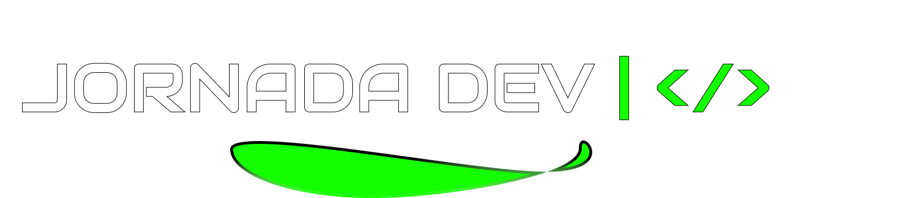

<div align="center">


# Jornada Dev

**Landing page responsiva • Identidade Black Neon • Microinterações**

[](https://jornadadev.netlify.app/)


[**🌐 Abrir o Jornada Dev**](https://jornadadev.netlify.app/)

</div>

## Sobre o projeto

Redesign de uma landing page de mentoria em programação, com visual preto e verde-neon, fotografias do projeto original, tipografia marcante e movimentos sutis.

## Prévia visual

> A arte de capa acima representa a identidade visual. Para ver a interface real, clique em **Abrir o Jornada Dev**. A imagem abaixo é um recurso fotográfico original utilizado no site, não uma captura de tela.

<div align="center">

</div>

## Destaques

- Design responsivo para desktop, tablet e celular
- Animações de entrada e interações ao passar o mouse
- Navegação entre seções e rolagem suave
- Preferência de movimento reduzido respeitada
- HTML, CSS e JavaScript sem dependência de framework

## Executar localmente

Abra `index.html` no navegador, ou rode `python -m http.server 8000` e acesse `http://localhost:8000`.

## Publicação

O arquivo `netlify.toml` configura a publicação da raiz do repositório. No Netlify, importe o repositório do GitHub, deixe o comando de build vazio e use `.` como diretório de publicação.

## Estrutura

```text
index.html
netlify.toml
assets/
  css/style.css
  js/main.js
  images/
  preview/banner.svg
README.md
```

---

<div align="center"><sub>Jornada Dev • Projeto de portfólio</sub></div>
